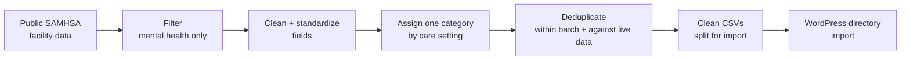

# CWN Data Pipeline

Python pipeline that turns public SAMHSA mental health facility data into clean, import-ready directory listings.

## Index
- [Goal](#goal)
- [Description](#description)
- [How It Works](#how-it-works)
- [Skills](#skills)
- [Technology](#technology)
- [Results](#results)
- [Repository Structure](#repository-structure)
- [Setup](#setup)
- [Note on Scope](#note-on-scope)

## Goal
Build a nationwide directory of mental health treatment facilities from public data, with clean, consistent records that can be imported into a WordPress directory without manual editing.

## Description
This repo documents the data pipeline behind [CrossingWatersNetwork.org](https://crossingwatersnetwork.org). The pipeline reads public SAMHSA facility data, filters it to mental health facilities only, standardizes each record, removes duplicates, assigns a care category, and writes CSV files for import into WordPress with the GeoDirectory plugin.

This is a **simplified public version**. It shows the design and the results. Production code, configuration values and credentials are not included. The full version is available to walk through on request.

## How It Works



**Design decisions**
- **Config-driven:** states, care-setting codes and categories are set in a config file, not hard-coded, so the same pipeline can be reused for another directory.
- **Estimate before import:** an `--estimate` run reports expected row counts before any batch is generated.
- **One category per facility:** when a facility has several care settings, the highest-priority one wins (inpatient, then residential, then outpatient).
- **Phone-based publish rule:** records with a phone number are marked publish; records without one are held as pending. Missing phones are not dropped.
- **No invented data:** website fields stay empty when the source does not provide a real URL.
- **Large files are split** into smaller CSV parts so imports run reliably.

**Cleaning steps**
- Standardize text to plain ASCII and combine name lines
- Format 10- and 11-digit phone numbers consistently
- Keep ZIP codes as digits
- Convert state abbreviations to full state names
- Add state tags to every listing
- Generate a short listing description (up to 300 characters)
- Remove duplicates by title, city, ZIP and street, within the batch and against listings already live

## Skills
Data cleaning, ETL pipeline design, deduplication, data validation, CSV processing, configuration-driven design, WordPress data import, technical documentation.

## Technology
Python, CSV, YAML configuration, command-line tools, WordPress, GeoDirectory.

## Results
| Batch | Records |
|---|---|
| Inpatient + residential (cleaned) | 3,220 |
| Outpatient before overlap check | 10,534 |
| Outpatient removed as overlap with the first batch | 9 |
| Outpatient new to import | 10,525 |
| **Total live directory listings** | **13,745** |

The two batches add up exactly (3,220 + 10,525 = 13,745), and the 9 overlapping records were caught and removed instead of being published twice.

## Repository Structure
```
cwn-data-pipeline/
├── README.md
├── .gitignore
├── config/
│   └── example-config.yaml     # example structure only
├── scripts/
│   └── pipeline_outline.py     # step order only, no production logic
└── images/
```

## Setup
This repo is documentation and structure only. The production script is not included.

## Note on Scope
Production code, real configuration values and credentials are intentionally left out.
